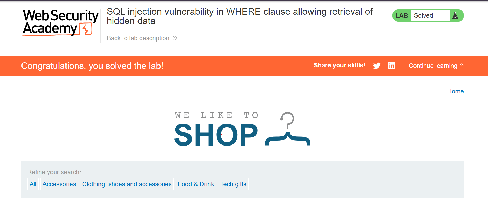
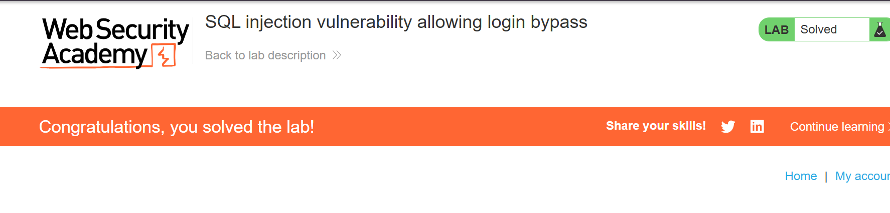
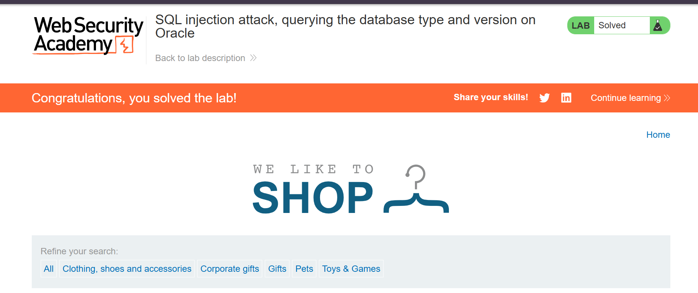
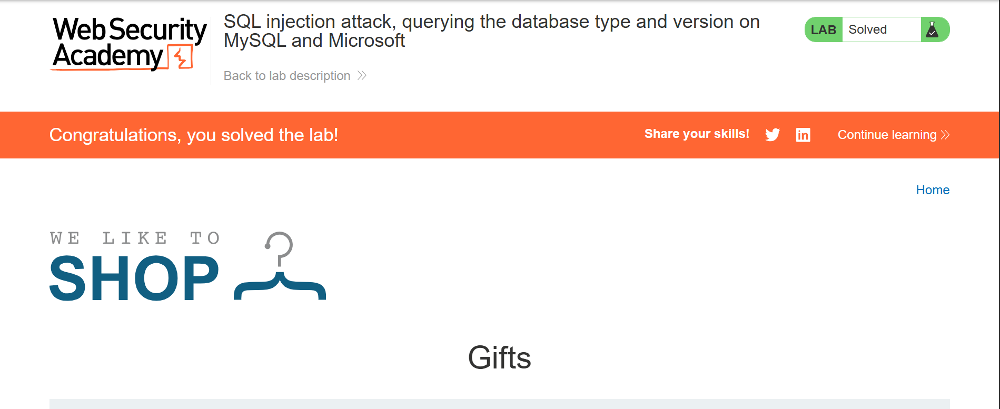

# PortSwigger Web Security Academy – Solved Labs


This repository documents my journey through **PortSwigger Web Security Academy** practical labs.

My goal is to learn web application security, understand common vulnerabilities, and develop practical penetration testing skills using Burp Suite.

## Learning Goals

- Understand common web vulnerabilities.
- Practice identifying and exploiting vulnerabilities in legal lab environments.
- Learn how to use Burp Suite effectively.
- Document my learning process and solutions.
- Improve my web application penetration testing skills.

## Progress Overview

| Level | Completed Labs |
|---|---:|
| Apprentice | 4 |
| Practitioner | 0 |
| Expert | 0 |
| **Total** | **4** |

## Categories Covered

| Category | Completed |
|---|---:|
| SQL Injection | 4 |
| Cross-Site Scripting (XSS) | 0 |
| Authentication | 0 |
| Access Control | 0 |
| Other Vulnerabilities | 0 |

## Tools Used

- Burp Suite Community Edition
- Kali Linux
- PortSwigger Web Security Academy
- VirtualBox
- Oracle Database and MySQL lab environments

## Repository Structure

```text
portswigger-labs-tracker/
│
├── README.md
│
├── SQL-Injection/
│   ├── lab-01-hidden-data.md
│   ├── lab-02-login-bypass.md
│   ├── lab-03-oracle-database-version.md
│   └── lab-04-mysql-microsoft-database-version.md
│
└── Screenshots/
    ├── lab-01-solved.png
    ├── lab-02-solved.png
    ├── lab-03-solved.png
    └── lab-04-solved.png
```

## Solved Labs

| No. | Lab Title | Difficulty | Status |
|---|---|---|---|
| 01 | SQL Injection – Retrieving Hidden Data | Apprentice | ✅ Solved |
| 02 | SQL Injection – Login Bypass | Apprentice | ✅ Solved |
| 03 | SQL Injection – Querying Database Version on Oracle | Apprentice | ✅ Solved |
| 04 | SQL Injection – Querying Database Version on MySQL and Microsoft | Apprentice | ✅ Solved |

## Lab Write-ups

1. [Lab 01 – SQL Injection: Retrieving Hidden Data](SQL-Injection/lab-01-hidden-data.md)
2. [Lab 02 – SQL Injection: Login Bypass](SQL-Injection/lab-02-login-bypass.md)
3. [Lab 03 – SQL Injection: Querying Database Version on Oracle](SQL-Injection/lab-03-oracle-database-version.md)
4. [Lab 04 – SQL Injection: Querying Database Version on MySQL and Microsoft](SQL-Injection/lab-04-mysql-microsoft-database-version.md)

## Lab Screenshots

### Lab 01 – Retrieving Hidden Data


### Lab 02 – Login Bypass


### Lab 03 – Oracle Database Version


### Lab 04 – MySQL and Microsoft Database Version


## Key Concepts Learned

- SQL injection in WHERE clauses.
- Boolean-based SQL injection.
- SQL injection authentication bypass.
- UNION-based SQL injection.
- Identifying the number of columns using ORDER BY.
- Retrieving database information.
- Oracle database version retrieval using `v$version`.
- MySQL database version retrieval using `@@version`.
- SQL comments and query manipulation.
- Preventing SQL injection using parameterized queries.

## Disclaimer

All practical exercises documented here were performed in authorized PortSwigger Web Security Academy lab environments for educational purposes.

## Learning Journey

**Learning cybersecurity one vulnerability at a time.**

Stay curious. Keep practicing. Keep learning. 🔐
